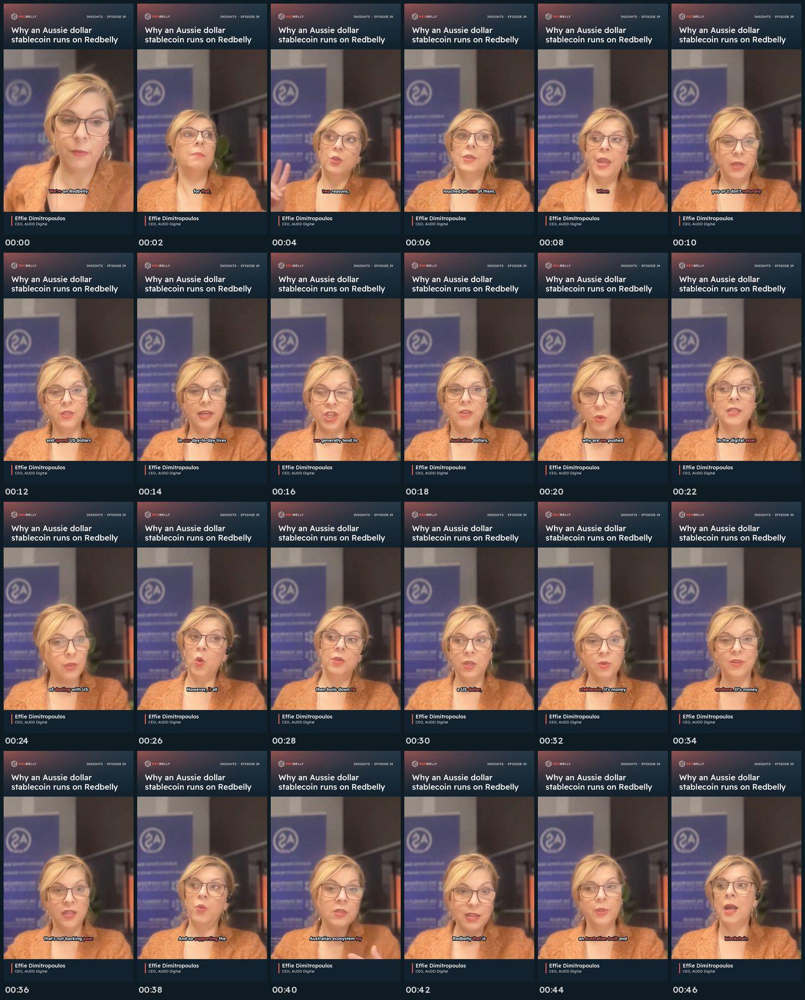
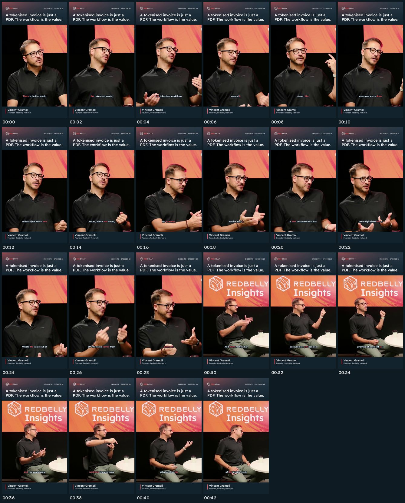
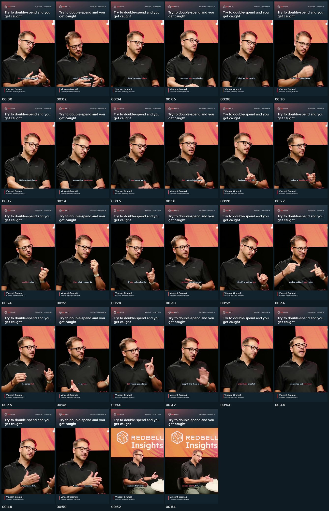
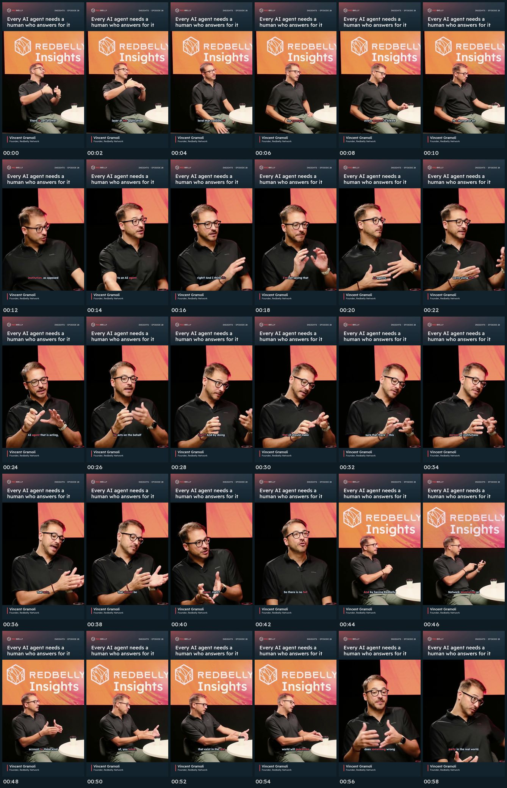
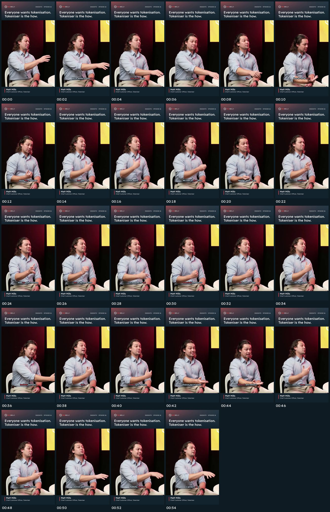
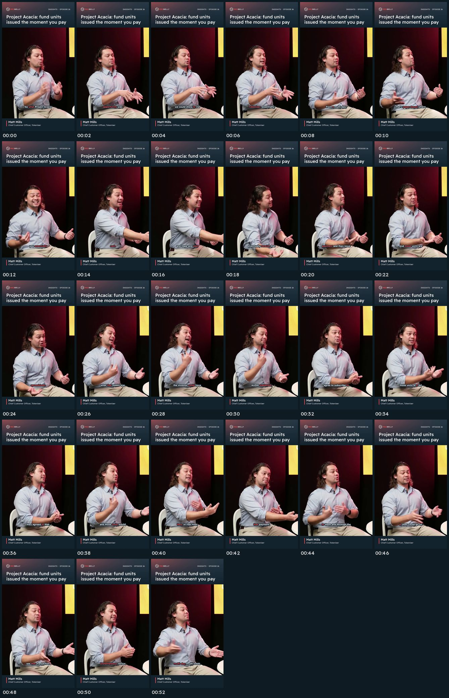

# Verification

Generated by `python3 tools/build_docs.py`. Specs, loudness and subtitle files are measured from the MP4/SRT in this repository. The audio, edit and frame checks come from `tools/verify_av.py`, which compares each clip with the official episode file and its own audio ([`verification/report.json`](verification/report.json), tied to each MP4 and SRT by SHA-256). Every difference those checks find has to carry a manual verdict in [`verification/review.json`](verification/review.json) or the build fails.

**151 of 151 checks pass.**

- [All checks](#all-checks)
- [Subtitles against the audio](#subtitles-against-the-audio)
- [Edits against the source episode](#edits-against-the-source-episode)
- [What is on screen](#what-is-on-screen)
- [Human review](#human-review)
- [Review notes on the automated findings](#review-notes-on-the-automated-findings)

## All checks

| Clip | Check | Result | Measured |
|------|-------|--------|----------|
| 01-audd-sovereignty | 9:16, 1080p or higher | PASS | 1080x1920 |
| 01-audd-sovereignty | 24 fps or higher | PASS | 30.00 fps |
| 01-audd-sovereignty | MP4 / H.264 + AAC | PASS | h264 + aac |
| 01-audd-sovereignty | 30-60 s | PASS | 47.9 s |
| 01-audd-sovereignty | Loudness -14 LUFS +/-1 | PASS | -14.1 LUFS, peak -1.4 dBFS |
| 01-audd-sovereignty | Audio frames evenly timed (no gaps or overlaps) | PASS | 2246 AAC frames of 1024 samples |
| 01-audd-sovereignty | Subtitle spelling (Redbelly, Tokeniser, Acacia...) | PASS | clean |
| 01-audd-sovereignty | No personal credit in file or subtitles | PASS | none |
| 01-audd-sovereignty | Distinct point | PASS | Why an Aussie dollar stablecoin runs on Redbelly |
| 01-audd-sovereignty | SRT cues in sequence, no overlaps | PASS | 45 cues |
| 01-audd-sovereignty | Audio/visual report is for this MP4 and SRT | PASS | sha256 match |
| 01-audd-sovereignty | Subtitles vs independent transcript of the clip audio | PASS | 96.2% word match (large-v3), 7 differences |
| 01-audd-sovereignty | Every subtitle difference reviewed against the audio | PASS | 7 of 7 reviewed |
| 01-audd-sovereignty | Subtitle timing (word spoken while its cue is on screen) | PASS | 100.0% of 124 words within 0.3 s |
| 01-audd-sovereignty | Clip audio is exactly the listed source ranges | PASS | 4 ranges, start/end within 3 ms (correlation 0.99) |
| 01-audd-sovereignty | Every edit point in a pause between words | PASS | 7 of 8 in a pause (-20 dB or quieter), 1 in connected speech reviewed |
| 01-audd-sovereignty | First and last word of every range heard whole | PASS | 8 of 8 edit points match the subtitles |
| 01-audd-sovereignty | Branded frame unchanged in every frame | PASS | 96 frames, max difference 0.8/255 |
| 01-audd-sovereignty | On-screen name, role, hook and episode (OCR) | PASS | Effie Dimitropoulos CEO, AUDD Digital |
| 01-audd-sovereignty | No credits, handles or URLs on screen (OCR every second) | PASS | none |
| 01-audd-sovereignty | Any other on-screen text reviewed | PASS | none |
| 01-audd-sovereignty | Speaker's face in frame | PASS | 100% of frames |
| 01-audd-sovereignty | No black or frozen video | PASS | none |
| 01-audd-sovereignty | Contact sheet reviewed | PASS | reviewed (see review notes) |
| 01-audd-sovereignty | Watched and listened in full by a person | PASS | 0xDarkSeidBull, 2026-10-29 |
| 02-tokenised-workflows | 9:16, 1080p or higher | PASS | 1080x1920 |
| 02-tokenised-workflows | 24 fps or higher | PASS | 30.00 fps |
| 02-tokenised-workflows | MP4 / H.264 + AAC | PASS | h264 + aac |
| 02-tokenised-workflows | 30-60 s | PASS | 43.3 s |
| 02-tokenised-workflows | Loudness -14 LUFS +/-1 | PASS | -14.0 LUFS, peak -1.3 dBFS |
| 02-tokenised-workflows | Audio frames evenly timed (no gaps or overlaps) | PASS | 2029 AAC frames of 1024 samples |
| 02-tokenised-workflows | Subtitle spelling (Redbelly, Tokeniser, Acacia...) | PASS | clean |
| 02-tokenised-workflows | No personal credit in file or subtitles | PASS | none |
| 02-tokenised-workflows | Distinct point | PASS | A tokenised invoice is just a PDF. The workflow is the value. |
| 02-tokenised-workflows | SRT cues in sequence, no overlaps | PASS | 43 cues |
| 02-tokenised-workflows | Audio/visual report is for this MP4 and SRT | PASS | sha256 match |
| 02-tokenised-workflows | Subtitles vs independent transcript of the clip audio | PASS | 98.6% word match (large-v3), 3 differences |
| 02-tokenised-workflows | Every subtitle difference reviewed against the audio | PASS | 3 of 3 reviewed |
| 02-tokenised-workflows | Subtitle timing (word spoken while its cue is on screen) | PASS | 100.0% of 110 words within 0.3 s |
| 02-tokenised-workflows | Clip audio is exactly the listed source ranges | PASS | 2 ranges, start/end within 0 ms (correlation 0.99) |
| 02-tokenised-workflows | Every edit point in a pause between words | PASS | 3 of 4 in a pause (-20 dB or quieter), 1 in connected speech reviewed |
| 02-tokenised-workflows | First and last word of every range heard whole | PASS | 4 of 4 edit points match the subtitles |
| 02-tokenised-workflows | Branded frame unchanged in every frame | PASS | 87 frames, max difference 0.6/255 |
| 02-tokenised-workflows | On-screen name, role, hook and episode (OCR) | PASS | Vincent Gramoli Founder, Redbelly Network |
| 02-tokenised-workflows | No credits, handles or URLs on screen (OCR every second) | PASS | none |
| 02-tokenised-workflows | Any other on-screen text reviewed | PASS | none |
| 02-tokenised-workflows | Speaker's face in frame | PASS | 100% of frames |
| 02-tokenised-workflows | No black or frozen video | PASS | none |
| 02-tokenised-workflows | Contact sheet reviewed | PASS | reviewed (see review notes) |
| 02-tokenised-workflows | Watched and listened in full by a person | PASS | 0xDarkSeidBull, 2026-10-29 |
| 03-accountable-consensus | 9:16, 1080p or higher | PASS | 1080x1920 |
| 03-accountable-consensus | 24 fps or higher | PASS | 30.00 fps |
| 03-accountable-consensus | MP4 / H.264 + AAC | PASS | h264 + aac |
| 03-accountable-consensus | 30-60 s | PASS | 56.3 s |
| 03-accountable-consensus | Loudness -14 LUFS +/-1 | PASS | -14.1 LUFS, peak -1.2 dBFS |
| 03-accountable-consensus | Audio frames evenly timed (no gaps or overlaps) | PASS | 2640 AAC frames of 1024 samples |
| 03-accountable-consensus | Subtitle spelling (Redbelly, Tokeniser, Acacia...) | PASS | clean |
| 03-accountable-consensus | No personal credit in file or subtitles | PASS | none |
| 03-accountable-consensus | Distinct point | PASS | Try to double-spend and you get caught |
| 03-accountable-consensus | SRT cues in sequence, no overlaps | PASS | 56 cues |
| 03-accountable-consensus | Audio/visual report is for this MP4 and SRT | PASS | sha256 match |
| 03-accountable-consensus | Subtitles vs independent transcript of the clip audio | PASS | 98.9% word match (large-v3), 3 differences |
| 03-accountable-consensus | Every subtitle difference reviewed against the audio | PASS | 3 of 3 reviewed |
| 03-accountable-consensus | Subtitle timing (word spoken while its cue is on screen) | PASS | 100.0% of 151 words within 0.3 s |
| 03-accountable-consensus | Clip audio is exactly the listed source ranges | PASS | 4 ranges, start/end within 0 ms (correlation 0.97) |
| 03-accountable-consensus | Every edit point in a pause between words | PASS | 7 of 8 in a pause (-20 dB or quieter), 1 in connected speech reviewed |
| 03-accountable-consensus | First and last word of every range heard whole | PASS | 7 of 8 edit points match the subtitles, 1 reviewed |
| 03-accountable-consensus | Branded frame unchanged in every frame | PASS | 112 frames, max difference 0.5/255 |
| 03-accountable-consensus | On-screen name, role, hook and episode (OCR) | PASS | Vincent Gramoli Founder, Redbelly Network |
| 03-accountable-consensus | No credits, handles or URLs on screen (OCR every second) | PASS | none |
| 03-accountable-consensus | Any other on-screen text reviewed | PASS | 34 reviewed |
| 03-accountable-consensus | Speaker's face in frame | PASS | 100% of frames |
| 03-accountable-consensus | No black or frozen video | PASS | none |
| 03-accountable-consensus | Contact sheet reviewed | PASS | reviewed (see review notes) |
| 03-accountable-consensus | Watched and listened in full by a person | PASS | 0xDarkSeidBull, 2026-10-29 |
| 04-ai-agent-accountability | 9:16, 1080p or higher | PASS | 1080x1920 |
| 04-ai-agent-accountability | 24 fps or higher | PASS | 30.00 fps |
| 04-ai-agent-accountability | MP4 / H.264 + AAC | PASS | h264 + aac |
| 04-ai-agent-accountability | 30-60 s | PASS | 59.3 s |
| 04-ai-agent-accountability | Loudness -14 LUFS +/-1 | PASS | -14.2 LUFS, peak -1.3 dBFS |
| 04-ai-agent-accountability | Audio frames evenly timed (no gaps or overlaps) | PASS | 2780 AAC frames of 1024 samples |
| 04-ai-agent-accountability | Subtitle spelling (Redbelly, Tokeniser, Acacia...) | PASS | clean |
| 04-ai-agent-accountability | No personal credit in file or subtitles | PASS | none |
| 04-ai-agent-accountability | Distinct point | PASS | Every AI agent needs a human who answers for it |
| 04-ai-agent-accountability | SRT cues in sequence, no overlaps | PASS | 53 cues |
| 04-ai-agent-accountability | Audio/visual report is for this MP4 and SRT | PASS | sha256 match |
| 04-ai-agent-accountability | Subtitles vs independent transcript of the clip audio | PASS | 95.6% word match (large-v3), 8 differences |
| 04-ai-agent-accountability | Every subtitle difference reviewed against the audio | PASS | 8 of 8 reviewed |
| 04-ai-agent-accountability | Subtitle timing (word spoken while its cue is on screen) | PASS | 100.0% of 152 words within 0.3 s |
| 04-ai-agent-accountability | Clip audio is exactly the listed source ranges | PASS | 3 ranges, start/end within 0 ms (correlation 0.98) |
| 04-ai-agent-accountability | Every edit point in a pause between words | PASS | 6 of 6 in a pause (-20 dB or quieter) |
| 04-ai-agent-accountability | First and last word of every range heard whole | PASS | 5 of 6 edit points match the subtitles, 1 reviewed |
| 04-ai-agent-accountability | Branded frame unchanged in every frame | PASS | 119 frames, max difference 0.6/255 |
| 04-ai-agent-accountability | On-screen name, role, hook and episode (OCR) | PASS | Vincent Gramoli Founder, Redbelly Network |
| 04-ai-agent-accountability | No credits, handles or URLs on screen (OCR every second) | PASS | none |
| 04-ai-agent-accountability | Any other on-screen text reviewed | PASS | none |
| 04-ai-agent-accountability | Speaker's face in frame | PASS | 100% of frames |
| 04-ai-agent-accountability | No black or frozen video | PASS | none |
| 04-ai-agent-accountability | Contact sheet reviewed | PASS | reviewed (see review notes) |
| 04-ai-agent-accountability | Watched and listened in full by a person | PASS | 0xDarkSeidBull, 2026-10-29 |
| 05-tokeniser-gateway | 9:16, 1080p or higher | PASS | 1080x1920 |
| 05-tokeniser-gateway | 24 fps or higher | PASS | 30.00 fps |
| 05-tokeniser-gateway | MP4 / H.264 + AAC | PASS | h264 + aac |
| 05-tokeniser-gateway | 30-60 s | PASS | 56.2 s |
| 05-tokeniser-gateway | Loudness -14 LUFS +/-1 | PASS | -14.4 LUFS, peak -1.3 dBFS |
| 05-tokeniser-gateway | Audio frames evenly timed (no gaps or overlaps) | PASS | 2634 AAC frames of 1024 samples |
| 05-tokeniser-gateway | Subtitle spelling (Redbelly, Tokeniser, Acacia...) | PASS | clean |
| 05-tokeniser-gateway | No personal credit in file or subtitles | PASS | none |
| 05-tokeniser-gateway | Distinct point | PASS | Everyone wants tokenisation. Tokeniser is the how. |
| 05-tokeniser-gateway | SRT cues in sequence, no overlaps | PASS | 53 cues |
| 05-tokeniser-gateway | Audio/visual report is for this MP4 and SRT | PASS | sha256 match |
| 05-tokeniser-gateway | Subtitles vs independent transcript of the clip audio | PASS | 98.6% word match (large-v3), 3 differences |
| 05-tokeniser-gateway | Every subtitle difference reviewed against the audio | PASS | 3 of 3 reviewed |
| 05-tokeniser-gateway | Subtitle timing (word spoken while its cue is on screen) | PASS | 100.0% of 151 words within 0.3 s |
| 05-tokeniser-gateway | Clip audio is exactly the listed source ranges | PASS | 2 ranges, start/end within 0 ms (correlation 0.94) |
| 05-tokeniser-gateway | Every edit point in a pause between words | PASS | 4 of 4 in a pause (-20 dB or quieter) |
| 05-tokeniser-gateway | First and last word of every range heard whole | PASS | 4 of 4 edit points match the subtitles |
| 05-tokeniser-gateway | Branded frame unchanged in every frame | PASS | 112 frames, max difference 0.6/255 |
| 05-tokeniser-gateway | On-screen name, role, hook and episode (OCR) | PASS | Matt Mills Chief Customer Officer, Tokeniser |
| 05-tokeniser-gateway | No credits, handles or URLs on screen (OCR every second) | PASS | none |
| 05-tokeniser-gateway | Any other on-screen text reviewed | PASS | 1 reviewed |
| 05-tokeniser-gateway | Speaker's face in frame | PASS | 100% of frames |
| 05-tokeniser-gateway | No black or frozen video | PASS | none |
| 05-tokeniser-gateway | Contact sheet reviewed | PASS | reviewed (see review notes) |
| 05-tokeniser-gateway | Watched and listened in full by a person | PASS | 0xDarkSeidBull, 2026-10-29 |
| 06-acacia-instant-subscription | 9:16, 1080p or higher | PASS | 1080x1920 |
| 06-acacia-instant-subscription | 24 fps or higher | PASS | 30.00 fps |
| 06-acacia-instant-subscription | MP4 / H.264 + AAC | PASS | h264 + aac |
| 06-acacia-instant-subscription | 30-60 s | PASS | 52.9 s |
| 06-acacia-instant-subscription | Loudness -14 LUFS +/-1 | PASS | -14.4 LUFS, peak -1.1 dBFS |
| 06-acacia-instant-subscription | Audio frames evenly timed (no gaps or overlaps) | PASS | 2479 AAC frames of 1024 samples |
| 06-acacia-instant-subscription | Subtitle spelling (Redbelly, Tokeniser, Acacia...) | PASS | clean |
| 06-acacia-instant-subscription | No personal credit in file or subtitles | PASS | none |
| 06-acacia-instant-subscription | Distinct point | PASS | Project Acacia: fund units issued the moment you pay |
| 06-acacia-instant-subscription | SRT cues in sequence, no overlaps | PASS | 46 cues |
| 06-acacia-instant-subscription | Audio/visual report is for this MP4 and SRT | PASS | sha256 match |
| 06-acacia-instant-subscription | Subtitles vs independent transcript of the clip audio | PASS | 99.1% word match (large-v3), 2 differences |
| 06-acacia-instant-subscription | Every subtitle difference reviewed against the audio | PASS | 2 of 2 reviewed |
| 06-acacia-instant-subscription | Subtitle timing (word spoken while its cue is on screen) | PASS | 100.0% of 145 words within 0.3 s |
| 06-acacia-instant-subscription | Clip audio is exactly the listed source ranges | PASS | 2 ranges, start/end within 0 ms (correlation 0.98) |
| 06-acacia-instant-subscription | Every edit point in a pause between words | PASS | 4 of 4 in a pause (-20 dB or quieter) |
| 06-acacia-instant-subscription | First and last word of every range heard whole | PASS | 4 of 4 edit points match the subtitles |
| 06-acacia-instant-subscription | Branded frame unchanged in every frame | PASS | 106 frames, max difference 0.6/255 |
| 06-acacia-instant-subscription | On-screen name, role, hook and episode (OCR) | PASS | Matt Mills Chief Customer Officer, Tokeniser |
| 06-acacia-instant-subscription | No credits, handles or URLs on screen (OCR every second) | PASS | none |
| 06-acacia-instant-subscription | Any other on-screen text reviewed | PASS | none |
| 06-acacia-instant-subscription | Speaker's face in frame | PASS | 100% of frames |
| 06-acacia-instant-subscription | No black or frozen video | PASS | none |
| 06-acacia-instant-subscription | Contact sheet reviewed | PASS | reviewed (see review notes) |
| 06-acacia-instant-subscription | Watched and listened in full by a person | PASS | 0xDarkSeidBull, 2026-10-29 |
| pack | 6 clips | PASS | 6 |

Loudness spread across the pack: 0.4 LU (-14.4 to -14.0 LUFS integrated).

## Subtitles against the audio

The final audio of each clip was transcribed again with Whisper `large-v3`, a different and larger model than the `medium.en` used for the subtitles, and compared word by word with the SRT (case, punctuation, hyphens, fillers and British/American spelling ignored). Every remaining difference is listed with the verdict after checking that moment of the audio.

Timing is measured with a third model, wav2vec 2.0 (a CTC speech model, run through torchaudio), because Whisper's word times drift by up to a second around pauses and fillers while a CTC model's words are tied to 20 ms frames. It is also a different model from the MMS_FA aligner that timed the subtitles. A word counts as on time when the midpoint of the word as wav2vec 2.0 hears it is within 0.3 s of its cue being on screen; every word outside that is listed with a verdict.

### 01-audd-sovereignty

96.2% word match (137 subtitle words, 129 transcript words); 100.0% of 124 words on time.

| Clip time | Subtitles | Independent transcript | Verdict |
|---|---|---|---|
| 00:02.4 | for that | (nothing) | Said twice: "We're on Redbelly for that, um, for that exact reason." wav2vec 2.0 hears "for that" at 0.8 s and again at 2.4 s, and small.en, with the opening transcribed on its own, hears "for that for that exact reason"; large-v3 hears it once. The restart is shown, like other audible false starts. |
| 00:03.4 | Two, | (nothing) | Spoken: "for that exact reason. Two, well, two reasons". With 3.0-5.8 s of the clip transcribed on its own, all four models (large-v3, medium.en, small.en and wav2vec 2.0) hear "two" before "well" as well as after it; the full-clip pass drops the first. |
| 00:05.1 | I mean, | (nothing) | Spoken: "you know, I, I mean, touched on one of them". With that moment transcribed on its own, medium.en and small.en hear "I mean" and wav2vec 2.0 hears "I, I mean"; scored by forced alignment against the audio, "I, I mean" fits better than a single "I". large-v3 hears "I" once. |
| 00:19.7 | why | (nothing) | Said twice: "then why, uh, why are we pushed". wav2vec 2.0 hears "why" at 19.97 s and again at 20.63 s, and large-v3 and small.en, with that moment transcribed on its own, also hear it twice; the full-clip pass hears it once. |
| 00:22.4 | of, | (nothing) | Said twice: "space of, of dealing with US dollars". With that moment transcribed on its own, wav2vec 2.0 hears "of" at 24.1 s and again at 24.8 s and small.en hears "of, of"; large-v3 and medium.en hear it once. |
| 00:31.4 | (nothing) | a | Not spoken. With 31.3-34.0 s of the clip transcribed on its own, large-v3 and medium.en hear "and especially US dollar stablecoin" with no "a", and so does wav2vec 2.0; only small.en, in one of two passes, and the full-clip pass hear an "a" before "US". |
| 00:43.5 | an Australian-built | (nothing) | A restart: Effie says "an Australian" and starts again, "an Australian-built". With 43.6-46.0 s transcribed on its own, all four models hear "Australian" twice (Whisper reads the sound joining them as "now"); scored by forced alignment with wav2vec 2.0, "an Australian, an Australian-built" fits the audio best, better than "now" or "Australian-owned". The full-clip pass hears the word once. |

### 02-tokenised-workflows

98.6% word match (140 subtitle words, 140 transcript words); 100.0% of 110 words on time.

| Clip time | Subtitles | Independent transcript | Verdict |
|---|---|---|---|
| 00:00.0 | (nothing) | Yeah, | Not spoken. The clip opens on a 0.4 s silent beat, and the only sound before "There" is the first 0.1 s of the range, where "I think" runs into "There" (see the edit point at 05:40.2). With the opening transcribed on its own, large-v3 hears "There is limited use in the tokenised asset" with no "yeah"; medium.en and small.en read that sound as "If" in a short window, and small.en as "Yeah" in a longer one. |
| 00:02.2 | the | (nothing) | Spoken: with 0-3.4 s of the clip transcribed on its own, large-v3 and medium.en hear "use in the tokenised asset" in both windows, and wav2vec 2.0 hears "the" at 2.2 s; the full-clip pass drops it. |
| 00:09.7 | cases | case | "cases" is spoken: focused small.en and medium.en hear "use cases" (focused large-v3 hears "use case"); the speaker refers to several use cases. |

### 03-accountable-consensus

98.9% word match (183 subtitle words, 185 transcript words); 100.0% of 151 words on time.

| Clip time | Subtitles | Independent transcript | Verdict |
|---|---|---|---|
| 00:00.0 | You | (nothing) | "You" is spoken. With the clip's opening transcribed on its own (a second of silence before it), large-v3, small.en and medium.en all hear "You know, the consensus is central to blockchain"; the full-clip pass drops it. |
| 00:48.1 | (nothing) | if you | Said once. With the start of the range transcribed on its own (47.9-49.8 s and 47.3-50.2 s), large-v3, medium.en, small.en and wav2vec 2.0 all hear a single "If you know that", and forced alignment of both texts against the audio strongly favours the single one. The doubled "if you" in the full-clip pass echoes the "if you, if you're" that the cut at 13:02.2 leaves out. |
| 00:50.9 | (nothing) | right | Not spoken. Focused large-v3 and small.en passes over 13:02-13:08 hear "before cheating because there is a risk" with no "right". |

### 04-ai-agent-accountability

95.6% word match (163 subtitle words, 157 transcript words); 100.0% of 152 words on time.

| Clip time | Subtitles | Independent transcript | Verdict |
|---|---|---|---|
| 00:18.9 | Redbelly | RedBilly | Misrecognition of "Redbelly" by the transcription model. |
| 00:25.4 | he | it | "he" is spoken: the focused large-v3 pass over 17:36-17:41 and medium.en hear "he acts on the behalf" (small.en hears "it"). |
| 00:32.0 | a this, this, | (nothing) | Spoken: "there is a this, this, this person or institutions". With 32.0-35.4 s transcribed on its own, large-v3, medium.en and small.en all hear "this" three times, and wav2vec 2.0 hears "a this this this person"; scored by forced alignment, that text fits the audio far better than a single "this". The "a" was also heard by the person reviewing the clip (large-v3 reads it as "um"). |
| 00:35.2 | institutions | institution | "institutions" is spoken: focused large-v3 and small.en passes over 17:44-17:49 both hear "person or institutions that act". |
| 00:37.4 | it | (nothing) | Spoken: "that acts, that it should be responsible". wav2vec 2.0 hears "that it should" in every pass, and medium.en and small.en hear a short word there too ("that is should") in a focused window; scored by forced alignment with wav2vec 2.0, "it" fits better than "is" or nothing. large-v3 hears neither. |
| 00:43.9 | again, | (nothing) | Spoken: "And again, by having Redbelly Network". With 43.9-45.6 s transcribed on its own, medium.en hears "and again by having", wav2vec 2.0 "and again" and small.en "and agree"; large-v3 reads it as "Agreed" in one window and drops it in the full-clip pass. Scored by forced alignment, "And again" fits the audio far better than "And" alone. |
| 00:48.6 | this | these | "this" is spoken: with 47.8-50.0 s transcribed on its own, large-v3, medium.en, small.en and wav2vec 2.0 all hear "to this kind of, you know", and forced alignment with wav2vec 2.0 also favours "this". |
| 00:57.1 | yeah, | (nothing) | Spoken by Vincent: "who does something wrong, yeah, will have a responsible party". With 54.8-58.6 s transcribed on its own, wav2vec 2.0, medium.en and small.en hear "yeah" in both windows and large-v3 in one, and his lips move on it in the video. |

### 05-tokeniser-gateway

98.6% word match (175 subtitle words, 172 transcript words); 100.0% of 151 words on time.

| Clip time | Subtitles | Independent transcript | Verdict |
|---|---|---|---|
| 00:10.5 | Yeah, and | (nothing) | Spoken by Matt Mills: "how do we do this? Yeah, and that's very much why Tokeniser exists". With 9.6-11.6 s transcribed on its own, large-v3, medium.en, small.en and wav2vec 2.0 all hear "yeah, and", and his lips move on it in the video; the full-clip pass drops both words. |
| 00:29.8 | to | (nothing) | Spoken: "essentially tokenise to their assets". With 29.6-32.2 s and 28.0-32.6 s transcribed on their own, large-v3, medium.en, small.en and wav2vec 2.0 all hear "tokenise to their assets", and forced alignment of both texts against the audio favours it; the full-clip pass drops it. |
| 00:44.2 | and | It | "and" is spoken: focused large-v3 and small.en passes over 7:58-8:03 both hear "Redbelly Network and makes it easy". |

### 06-acacia-instant-subscription

99.1% word match (158 subtitle words, 157 transcript words); 100.0% of 145 words on time.

| Clip time | Subtitles | Independent transcript | Verdict |
|---|---|---|---|
| 00:26.7 | they could, | (nothing) | Spoken: a restart, "what that meant was they could, the investor could have AUDM stablecoin". With 25.6-28.4 s transcribed on its own, large-v3, small.en and wav2vec 2.0 hear "they could" (medium.en reads it as "that"), and forced alignment of both texts against the audio strongly favours it; the full-clip pass drops it. |
| 00:49.2 | (nothing) | Fantastic. | Said once. Focused large-v3 and small.en passes over 20:51-20:57 hear a single "Fantastic.". |

## Edits against the source episode

**Ranges.** The start and end of every range in the clip were found in the official episode file by cross-correlating the audio. The error is the distance between where the audio actually comes from and the timestamp listed in `clips.json` and `CLIPS.md`.

**Edit points.** For every point where a range starts or ends, the table gives the word on each side (the subtitles on the side that is kept, a transcript of the removed audio on the side that is dropped) and the level of the episode audio at that point relative to the speaker's loud passages. An edit point passes when it sits in a pause (-20 dB or quieter). Where two words run together with no pause, the edit is placed at the quietest point between them and carries a verdict. As a check that no word is clipped, the kept side of every edit point is also transcribed on its own (2.5 s, with the clip's 40 ms fade and a second of silence around it): the first word heard after a range starts and the last word heard before it ends must be the subtitles' first and last word.

**Cuts.** The words left out at each cut are listed under each clip in [`CLIPS.md`](CLIPS.md).

### 01-audd-sovereignty

| Range | Listed | Start error | End error | Correlation |
|---|---|---|---|---|
| 1 | 43:03.3-43:11.5 | +0 ms | +0 ms | 1.00 |
| 2 | 43:20.8-43:28.8 | +0 ms | -0 ms | 1.00 |
| 3 | 43:40.5-43:49.8 | -3 ms | -3 ms | 0.99 |
| 4 | 44:06.6-44:29.1 | -3 ms | -3 ms | 0.99 |

| Edit point | Episode | Clip | Word before | Word after | Heard on its own | Level | Verdict |
|---|---|---|---|---|---|---|---|
| range 1 in | 43:03.3 | 00:00.0 | right. | We're | we're | -14 dB | No pause between "that's exactly right" and "We're on Redbelly"; the edit is at the quietest point between the two words and the clip starts on "We're". |
| range 1 out | 43:11.5 | 00:08.2 | right? | I | right | -34 dB | clean |
| range 2 in | 43:20.8 | 00:08.2 | sovereignty. | When | when | -43 dB | clean |
| range 2 out | 43:28.8 | 00:16.1 | wallets, | um | wallets | -34 dB | clean |
| range 3 in | 43:40.5 | 00:16.1 | etc | we | we | -54 dB | clean |
| range 3 out | 43:49.8 | 00:25.3 | right? | And | right | -33 dB | clean |
| range 4 in | 44:06.6 | 00:25.3 | that. | However, | however | -30 dB | clean |
| range 4 out | 44:29.1 | 00:47.9 | important. | I | important | -67 dB | clean |

### 02-tokenised-workflows

| Range | Listed | Start error | End error | Correlation |
|---|---|---|---|---|
| 1 | 05:40.2-06:10.2 | +0 ms | +0 ms | 0.99 |
| 2 | 06:28.6-06:41.5 | +0 ms | +0 ms | 1.00 |

| Edit point | Episode | Clip | Word before | Word after | Heard on its own | Level | Verdict |
|---|---|---|---|---|---|---|---|
| range 1 in | 05:40.2 | 00:00.4 | think... | There | there | -13 dB | No pause between "I think" and "There is limited use": the release of the final "k" in "think" runs into "There". The edit is at the onset of "There", after that release; large-v3, small.en and medium.en all hear the clip start on "There is limited use" (from 340.11 or 340.15 they hear an extra "Okay"/"Yeah"). |
| range 1 out | 06:10.2 | 00:30.4 | right? | So | right | -25 dB | clean |
| range 2 in | 06:28.6 | 00:30.4 | right? | And | and | -28 dB | clean |
| range 2 out | 06:41.5 | 00:43.3 | itself. | Because | itself | -39 dB | clean |

### 03-accountable-consensus

| Range | Listed | Start error | End error | Correlation |
|---|---|---|---|---|
| 1 | 11:48.7-11:56.2 | +0 ms | +0 ms | 0.99 |
| 2 | 12:16.4-12:41.5 | +0 ms | +0 ms | 1.00 |
| 3 | 12:42.2-12:57.6 | +0 ms | +0 ms | 0.99 |
| 4 | 13:02.2-13:10.5 | +0 ms | +0 ms | 0.97 |

| Edit point | Episode | Clip | Word before | Word after | Heard on its own | Level | Verdict |
|---|---|---|---|---|---|---|---|
| range 1 in | 11:48.7 | 00:00.0 | follows. | You | you | -11 dB | "as follows, you know, the consensus" runs together with no pause; the edit is at the quietest point (-11 dB) after "follows". Large-v3, small.en and medium.en all hear the clip start on "You know, the consensus is central to blockchain". |
| range 1 out | 11:56.2 | 00:07.5 | double-spending. | So | spinning | -27 dB | The word ends before the edit: on its own, the last word of range 1 is heard whole by all three models (medium.en "double spending", small.en "double spendings", large-v3 "double spinning"). The subtitles use the speaker's term, "double-spending". |
| range 2 in | 12:16.4 | 00:07.5 | anyway. | What | what | -54 dB | clean |
| range 2 out | 12:41.5 | 00:32.7 | are. | Interesting. | are | -60 dB | clean |
| range 3 in | 12:42.2 | 00:32.7 | Interesting. | And | and | -36 dB | clean |
| range 3 out | 12:57.6 | 00:48.0 | responsible. | And | responsible | -34 dB | clean |
| range 4 in | 13:02.2 | 00:48.0 | mean, | If | if | -22 dB | clean |
| range 4 out | 13:10.5 | 00:56.3 | caught. | Yeah, | caught | -48 dB | clean |

### 04-ai-agent-accountability

| Range | Listed | Start error | End error | Correlation |
|---|---|---|---|---|
| 1 | 17:04.8-17:27.1 | +0 ms | -0 ms | 0.99 |
| 2 | 17:34.9-17:56.4 | -0 ms | -0 ms | 0.99 |
| 3 | 18:09.0-18:24.4 | -0 ms | -0 ms | 0.98 |

| Edit point | Episode | Clip | Word before | Word after | Heard on its own | Level | Verdict |
|---|---|---|---|---|---|---|---|
| range 1 in | 17:04.8 | 00:00.0 | MEV. | There | there | -60 dB | clean |
| range 1 out | 17:27.1 | 00:22.3 | that. | And | that | -51 dB | clean |
| range 2 in | 17:34.9 | 00:22.3 | costs. | But | but | -63 dB | clean |
| range 2 out | 17:56.4 | 00:43.8 | agent. | Yeah, | agent | -50 dB | clean |
| range 3 in | 18:09.0 | 00:43.8 | right? | And | i | -59 dB | Clean: the edit sits in a 0.1 s pause (-59 dB) before "And". Transcribed on its own without the voice-activity filter, large-v3, small.en and medium.en all hear the range start "And by having Redbelly Network"; with the filter, large-v3 reads the first word as "I". |
| range 3 out | 18:24.4 | 00:59.3 | world. | And | world | -60 dB | clean |

### 05-tokeniser-gateway

| Range | Listed | Start error | End error | Correlation |
|---|---|---|---|---|
| 1 | 07:10.4-07:27.9 | +0 ms | +0 ms | 0.99 |
| 2 | 07:34.3-08:12.9 | +0 ms | +0 ms | 0.94 |

| Edit point | Episode | Clip | Word before | Word after | Heard on its own | Level | Verdict |
|---|---|---|---|---|---|---|---|
| range 1 in | 07:10.4 | 00:00.0 | belly. | We've | we've | -51 dB | clean |
| range 1 out | 07:27.9 | 00:17.6 | issuers. | And | issuers | -41 dB | clean |
| range 2 in | 07:34.3 | 00:17.6 | matter. | We | we | -32 dB | clean |
| range 2 out | 08:12.9 | 00:56.2 | network. | Because | network | -46 dB | clean |

### 06-acacia-instant-subscription

| Range | Listed | Start error | End error | Correlation |
|---|---|---|---|---|
| 1 | 19:51.5-20:16.1 | +0 ms | -0 ms | 0.98 |
| 2 | 20:28.8-20:57.1 | +0 ms | -0 ms | 0.99 |

| Edit point | Episode | Clip | Word before | Word after | Heard on its own | Level | Verdict |
|---|---|---|---|---|---|---|---|
| range 1 in | 19:51.5 | 00:00.0 | opportunities. | So | so | -32 dB | clean |
| range 1 out | 20:16.1 | 00:24.5 | spreadsheet. | So | spreadsheet | -39 dB | clean |
| range 2 in | 20:28.8 | 00:24.5 | that. | So | so | -38 dB | clean |
| range 2 out | 20:57.1 | 00:52.9 | multi-week. | The | week | -40 dB | clean |

## What is on screen

Every frame of each clip was decoded at 2 fps. The branded header and footer were compared with the middle frame (any overlay, watermark or credit would change them), the on-screen name, role, hook and episode were read back with OCR, the 4:5 video window was OCR'd once a second for credits, handles, URLs or any other text, and a face detector checked that the speaker is in frame. The contact sheets show one frame every 2 seconds.

### 01-audd-sovereignty

- **Name and role read from the video:** Effie Dimitropoulos CEO, AUDD Digital
- **Hook read from the video:** Why an Aussie dollar stablecoin runs on Redbelly
- **Speaker's face found in:** 100% of 96 frames
- **Credits, handles or URLs:** none

### 02-tokenised-workflows

- **Name and role read from the video:** Vincent Gramoli Founder, Redbelly Network
- **Hook read from the video:** A tokenised invoice Is just a PDF. The workflow is the value.
- **Speaker's face found in:** 100% of 87 frames
- **Credits, handles or URLs:** none

### 03-accountable-consensus

- **Name and role read from the video:** Vincent Gramoli Founder, Redbelly Network
- **Hook read from the video:** Try to double-spend and you get caught
- **Speaker's face found in:** 100% of 112 frames
- **Credits, handles or URLs:** none
- **Other text in the video window:**
  - `some_` at 00:00.0: The brand name "some_" printed on the speaker's polo shirt, part of the episode footage (OCR also reads parts of it, "Sor", "som", "ome", or misreads it as "sony"). Not a credit.
  - `some` at 00:01.0: The brand name "some_" printed on the speaker's polo shirt, part of the episode footage (OCR also reads parts of it, "Sor", "som", "ome", or misreads it as "sony"). Not a credit.
  - `some_` at 00:03.0: The brand name "some_" printed on the speaker's polo shirt, part of the episode footage (OCR also reads parts of it, "Sor", "som", "ome", or misreads it as "sony"). Not a credit.
  - `some_` at 00:04.0: The brand name "some_" printed on the speaker's polo shirt, part of the episode footage (OCR also reads parts of it, "Sor", "som", "ome", or misreads it as "sony"). Not a credit.
  - `Some` at 00:05.0: The brand name "some_" printed on the speaker's polo shirt, part of the episode footage (OCR also reads parts of it, "Sor", "som", "ome", or misreads it as "sony"). Not a credit.
  - `some_` at 00:06.0: The brand name "some_" printed on the speaker's polo shirt, part of the episode footage (OCR also reads parts of it, "Sor", "som", "ome", or misreads it as "sony"). Not a credit.
  - `some-` at 00:07.0: The brand name "some_" printed on the speaker's polo shirt, part of the episode footage (OCR also reads parts of it, "Sor", "som", "ome", or misreads it as "sony"). Not a credit.
  - `some_` at 00:08.0: The brand name "some_" printed on the speaker's polo shirt, part of the episode footage (OCR also reads parts of it, "Sor", "som", "ome", or misreads it as "sony"). Not a credit.
  - `some` at 00:09.0: The brand name "some_" printed on the speaker's polo shirt, part of the episode footage (OCR also reads parts of it, "Sor", "som", "ome", or misreads it as "sony"). Not a credit.
  - `some_` at 00:13.0: The brand name "some_" printed on the speaker's polo shirt, part of the episode footage (OCR also reads parts of it, "Sor", "som", "ome", or misreads it as "sony"). Not a credit.
  - `some-` at 00:14.0: The brand name "some_" printed on the speaker's polo shirt, part of the episode footage (OCR also reads parts of it, "Sor", "som", "ome", or misreads it as "sony"). Not a credit.
  - `som` at 00:16.0: The brand name "some_" printed on the speaker's polo shirt, part of the episode footage (OCR also reads parts of it, "Sor", "som", "ome", or misreads it as "sony"). Not a credit.
  - `some` at 00:17.0: The brand name "some_" printed on the speaker's polo shirt, part of the episode footage (OCR also reads parts of it, "Sor", "som", "ome", or misreads it as "sony"). Not a credit.
  - `some` at 00:18.0: The brand name "some_" printed on the speaker's polo shirt, part of the episode footage (OCR also reads parts of it, "Sor", "som", "ome", or misreads it as "sony"). Not a credit.
  - `sony` at 00:20.0: The brand name "some_" printed on the speaker's polo shirt, part of the episode footage (OCR also reads parts of it, "Sor", "som", "ome", or misreads it as "sony"). Not a credit.
  - `Some` at 00:24.0: The brand name "some_" printed on the speaker's polo shirt, part of the episode footage (OCR also reads parts of it, "Sor", "som", "ome", or misreads it as "sony"). Not a credit.
  - `some_` at 00:27.0: The brand name "some_" printed on the speaker's polo shirt, part of the episode footage (OCR also reads parts of it, "Sor", "som", "ome", or misreads it as "sony"). Not a credit.
  - `some_` at 00:28.0: The brand name "some_" printed on the speaker's polo shirt, part of the episode footage (OCR also reads parts of it, "Sor", "som", "ome", or misreads it as "sony"). Not a credit.
  - `ome—` at 00:29.0: The brand name "some_" printed on the speaker's polo shirt, part of the episode footage (OCR also reads parts of it, "Sor", "som", "ome", or misreads it as "sony"). Not a credit.
  - `some-` at 00:30.0: The brand name "some_" printed on the speaker's polo shirt, part of the episode footage (OCR also reads parts of it, "Sor", "som", "ome", or misreads it as "sony"). Not a credit.
  - `some` at 00:31.0: The brand name "some_" printed on the speaker's polo shirt, part of the episode footage (OCR also reads parts of it, "Sor", "som", "ome", or misreads it as "sony"). Not a credit.
  - `some` at 00:33.0: The brand name "some_" printed on the speaker's polo shirt, part of the episode footage (OCR also reads parts of it, "Sor", "som", "ome", or misreads it as "sony"). Not a credit.
  - `some.` at 00:34.0: The brand name "some_" printed on the speaker's polo shirt, part of the episode footage (OCR also reads parts of it, "Sor", "som", "ome", or misreads it as "sony"). Not a credit.
  - `some_` at 00:35.0: The brand name "some_" printed on the speaker's polo shirt, part of the episode footage (OCR also reads parts of it, "Sor", "som", "ome", or misreads it as "sony"). Not a credit.
  - `some` at 00:36.0: The brand name "some_" printed on the speaker's polo shirt, part of the episode footage (OCR also reads parts of it, "Sor", "som", "ome", or misreads it as "sony"). Not a credit.
  - `some-` at 00:38.0: The brand name "some_" printed on the speaker's polo shirt, part of the episode footage (OCR also reads parts of it, "Sor", "som", "ome", or misreads it as "sony"). Not a credit.
  - `some-` at 00:39.0: The brand name "some_" printed on the speaker's polo shirt, part of the episode footage (OCR also reads parts of it, "Sor", "som", "ome", or misreads it as "sony"). Not a credit.
  - `some` at 00:40.0: The brand name "some_" printed on the speaker's polo shirt, part of the episode footage (OCR also reads parts of it, "Sor", "som", "ome", or misreads it as "sony"). Not a credit.
  - `some` at 00:41.0: The brand name "some_" printed on the speaker's polo shirt, part of the episode footage (OCR also reads parts of it, "Sor", "som", "ome", or misreads it as "sony"). Not a credit.
  - `Some` at 00:45.0: The brand name "some_" printed on the speaker's polo shirt, part of the episode footage (OCR also reads parts of it, "Sor", "som", "ome", or misreads it as "sony"). Not a credit.
  - `some` at 00:46.0: The brand name "some_" printed on the speaker's polo shirt, part of the episode footage (OCR also reads parts of it, "Sor", "som", "ome", or misreads it as "sony"). Not a credit.
  - `Some.` at 00:48.0: The brand name "some_" printed on the speaker's polo shirt, part of the episode footage (OCR also reads parts of it, "Sor", "som", "ome", or misreads it as "sony"). Not a credit.
  - `some` at 00:49.0: The brand name "some_" printed on the speaker's polo shirt, part of the episode footage (OCR also reads parts of it, "Sor", "som", "ome", or misreads it as "sony"). Not a credit.
  - `some-` at 00:50.0: The brand name "some_" printed on the speaker's polo shirt, part of the episode footage (OCR also reads parts of it, "Sor", "som", "ome", or misreads it as "sony"). Not a credit.

### 04-ai-agent-accountability

- **Name and role read from the video:** Vincent Gramoli Founder, Redbelly Network
- **Hook read from the video:** Every AI agent needs a human who answers for it
- **Speaker's face found in:** 100% of 119 frames
- **Credits, handles or URLs:** none

### 05-tokeniser-gateway

- **Name and role read from the video:** Matt Mills Chief Customer Officer, Tokeniser
- **Hook read from the video:** Everyone wants tokenisation. Tokeniser is the how.
- **Speaker's face found in:** 100% of 112 frames
- **Credits, handles or URLs:** none
- **Other text in the video window:**
  - `unif` at 00:40.0: OCR fusing or misreading burned-in caption words ("familiar, easy", "that very", "sense,", "their assets", "unit" read as "unif").

### 06-acacia-instant-subscription

- **Name and role read from the video:** Matt Mills Chief Customer Officer, Tokeniser
- **Hook read from the video:** Project Acacia: fund units issued the moment you pay
- **Speaker's face found in:** 100% of 106 frames
- **Credits, handles or URLs:** none

## Human review

**Reviewer:** 0xDarkSeidBull

Each clip was watched and listened to in full at normal speed by a person, after the automated checks had passed, comparing what is said with the burned-in captions and the SRT. Round 1 covered every clip. Round 2 re-checked every clip, with a list of the spots changed since round 1: the timing of the highlighted word, the words added under the verbatim rule, and the first seconds of audio.

### Round 1 (2026-10-29): 6 findings in 4 clips (clips 3 and 5 passed)

| Clip | At | Found | Fix |
|---|---|---|---|
| 01-audd-sovereignty | 00:16 | Jerky jump cut, with a lone "we" after it | Cut moved into the pause before "et cetera"; in round 2 the reviewer re-cut it by hand (see round 2) |
| 01-audd-sovereignty | 00:47 | "is" lit up while Effie pauses on "blockchain", before she says it | Word timing by forced alignment of the subtitle text to the audio; "is" now lights up when it is said, after the pause |
| 02-tokenised-workflows | 00:00 | "There is" starts the moment the video starts | 0.4 s silent beat on the speaker's first frame before "There is limited use" |
| 04-ai-agent-accountability | 00:15-00:16 | Subtitle "right? And I think"; the speaker says "right? So I think" | "right? So, and I think": the reviewer's "So", plus a short "and" that four models hear |
| 04-ai-agent-accountability | 00:32 | "a" missing in "there is a this" | "there is a this, this, this person" ("this" is said three times) |
| 06-acacia-instant-subscription | 00:04-00:05 | "to" missing in "we could show to via Tokeniser" | Added |

### Round 2 (2026-10-29): PASS, all six clips

| Clip | At | Found | Fix |
|---|---|---|---|
| 01-audd-sovereignty | 00:15-00:16 | The reviewer re-cut this edit by hand (CapCut), joining "and in our wallets," directly to "we generally tend to" and dropping "et cetera" | Ranges 2 and 3 updated to the new cut (43:20.8-43:28.8, 43:40.5-43:49.8). The reviewer's file was HEVC, so it was transcoded to H.264 (every frame at 49.9 dB PSNR or better against the reviewer's file, same audio), and the SRT was re-timed to the new cut after the watch |

Each clip's sign-off is recorded against the SHA-256 of its MP4 and SRT in [`verification/human_review.json`](verification/human_review.json), so any later change to a clip voids it until it is watched again.

## Review notes on the automated findings

Verdicts on every difference the automated checks list, written while preparing the clips. Each subtitle difference was re-checked by transcribing that moment of the clip again in short focused windows with further models (Whisper large-v3, medium.en and small.en, and the wav2vec 2.0 speech model) and by reading the waveform; edit points were placed from the waveform and checked by transcribing each side of the edit on its own. A person's own watch-through of the finished clips is recorded separately under Human review.

- **01-audd-sovereignty:** Effie Dimitropoulos is in frame in every sheet frame. The window stops above the episode's own lower-third, so her name and role appear once, in the clip's name card ("CEO, AUDD Digital"). No credits, handles, URLs or watermarks.
- **02-tokenised-workflows:** Vincent Gramoli is in frame in every sheet frame (the clip opens on a 0.4 s silent beat on his first frame, held for 0.2 s more while the episode is still on the host). From 30 s the episode's wide shot shows the official Redbelly Insights studio sign. Name card "Founder, Redbelly Network". No credits, handles, URLs or watermarks.
- **03-accountable-consensus:** Vincent Gramoli is in frame in every sheet frame; the last ranges use the episode's wide shot with the official Redbelly Insights studio sign. Name card "Founder, Redbelly Network". The only other text is the brand print on his shirt. No credits, handles, URLs or watermarks.
- **04-ai-agent-accountability:** Vincent Gramoli is in frame in every sheet frame, across the episode's close-up and wide shots (the wide shots show the official Redbelly Insights studio sign). Name card "Founder, Redbelly Network". No credits, handles, URLs or watermarks.
- **05-tokeniser-gateway:** Matt Mills is in frame in every sheet frame. Name card "Chief Customer Officer, Tokeniser". No credits, handles, URLs or watermarks.
- **06-acacia-instant-subscription:** Matt Mills is in frame in every sheet frame. Name card "Chief Customer Officer, Tokeniser". No credits, handles, URLs or watermarks.
